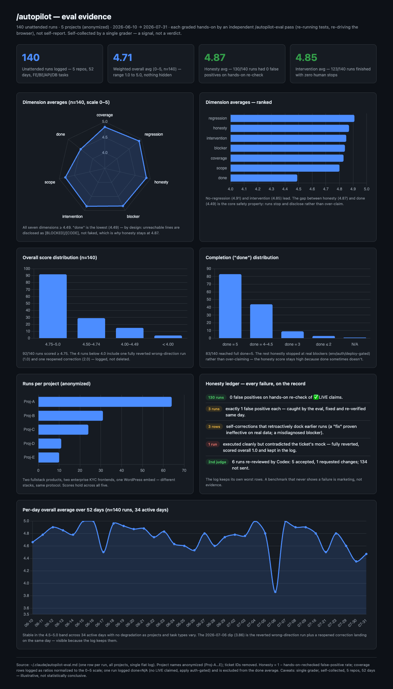

# autopilot

**English** | [中文](README.zh-CN.md)

Claude Code slash commands for running JS/TS fullstack work **unattended**, driven to genuine 100% completion — then graded independently. Plus `/demo-video`, which records the finished work as a demo video, and `/flow-check`, which walks the app as a real user and reports where the flow can be shorter.

- **`/autopilot <task or spec-path>`** — adopts a strict *completion condition* as a standing directive: maps every layer (FE/BE/API/DB/auth/tests/build), forbids self-authored scope-narrowing, runs the repo's real verification matrix, verifies in a real browser, and only stops when every requirement line is `[LIVE]`-verified or `[BLOCKED]` by a real external dependency. Built for when you're away and can't answer follow-ups.
- **`/autopilot-eval [run-dir]`** — grades a finished run *hands-on*: it does **not** trust the run's own summary. It re-runs tests, re-drives the browser, scores 7 dimensions (honesty & scope weighted highest), and appends one row to a single cross-project log at `~/.claude/autopilot-eval.md`.
- **`/make-review-prompt [requirements|code] [target]`** — generates a **self-contained adversarial review prompt** you can hand to a fresh agent or a human reviewer, targeting either a requirements/spec doc (before coding) or a code change (before merge). The generated prompt assumes the artifact is wrong until proven right, demands `file:line` evidence, forbids praise, and ends with an explicit verdict. Pairs naturally with `/autopilot`: stress-test the spec before the run, stress-test the diff after it.
- **`/autopilot-auto <task> [--session <id>] [--max-rounds N] [--timeout H]`** — combines `/autopilot` coding with an **automated adversarial review loop** powered by OpenAI Codex (CLI or Cursor plugin). You open two sessions — Claude Code for coding, Codex for reviewing — enter the same session ID on each side, and walk away. They communicate through a shared channel file (`.autopilot/reviews/<session-id>/channel.md`), polling every minute. The loop terminates when Codex approves, max rounds (default 10) are reached, or timeout (default 5h) expires. See [How to use `/autopilot-auto`](#how-to-use-autopilot-auto) below.
- **`/demo-video [mode=clip|walkthrough] [lang=en|zh] [voice=…] [music=…] …`** — records a real demo video of a web app with scripted Playwright: a **clip** (15–30 s proof of one fix or feature for a ticket or PR, with a before cut for bug fixes) or a **walkthrough** (minutes long, chapters, fast-forwarded waits, captions, optional English voice-over and music). It rehearses before recording, ends on the app's real result, keeps secrets out of frame, and an independent reviewer subagent must pass the cut before delivery. See [How to use `/demo-video`](#how-to-use-demo-video) below.
- **`/flow-check [feature | all] [flow|ux|recheck] [out=<dir>]`** — a flow-minimalist product review done in a real browser: it walks each user goal from the most likely starting point using only what is on screen, counts steps, pages, decisions and long waits, and asks of every step *can it be removed, merged, automated or deferred?* Each finding is ranked P0–P3 with a concrete fix and a browser-checkable "done when". The full report and screenshots go to a `flow-check-<date>-<topic>/` folder in the checked repo; the chat gets a short summary. It never changes code. See [How to use `/flow-check`](#how-to-use-flow-check) below.

> These are opinionated and intentionally strict. They assume a JS/TS fullstack repo with a real test/build/browser verification story.

> **Prerequisite — give it a well-designed spec.** `/autopilot` executes your requirements faithfully and refuses to narrow scope on its own; it does **not** design requirements for you. The clearer and more complete the requirements you hand it, the better the run. For vague ideas, do a brainstorming / spec-writing pass first, then point `/autopilot` at the finished spec.

## Install

### Option A — Claude Code plugin (recommended for sharing)

```
/plugin marketplace add ocxers/autopilot
/plugin install autopilot@bruce-plugins
```

Then invoke namespaced:

```
/autopilot:autopilot <task or spec-path>
/autopilot:autopilot-eval
/autopilot:make-review-prompt
/autopilot:autopilot-auto <task> [--session <id>] [--max-rounds N] [--timeout H]
/autopilot:demo-video [mode=clip|walkthrough] [lang=en|zh] …
/autopilot:flow-check [feature | all] [flow|ux|recheck] [out=<dir>]
```

To update later (`/plugin install` won't refresh an already-installed plugin):

```
/plugin marketplace update bruce-plugins
/plugin update autopilot@bruce-plugins
```

Or skip manual updates entirely: run `/plugin`, open the **Marketplaces** tab, and enable auto-update for `bruce-plugins` — new versions then install automatically on startup.

### Option B — install script (keeps the bare `/autopilot`)

Symlinks the commands into `~/.claude/commands/` and the `demo-video` and `flow-check` skills into `~/.claude/skills/`, so you keep the un-namespaced names:

```
git clone https://github.com/ocxers/autopilot.git
cd autopilot
./install.sh          # symlink (default) — git pull auto-updates the commands
./install.sh --copy   # copy instead of symlink
./install.sh --uninstall
```

Then invoke:

```
/autopilot <task or spec-path>
/autopilot-eval
/make-review-prompt [requirements|code] [target]
/autopilot-auto <task> [--session <id>] [--max-rounds N] [--timeout H]
/demo-video [mode=clip|walkthrough] [lang=en|zh] …
/flow-check [feature | all] [flow|ux|recheck] [out=<dir>]
```

If `~/.claude/skills/demo-video` or `~/.claude/skills/flow-check` already exists as a real directory (your own copy), the script leaves it alone and says so; move it away and re-run to use the repo version.

The script also seeds an **empty** eval log at `~/.claude/autopilot-eval.md` if you don't already have one. It never overwrites an existing log.

## How to use `/autopilot-auto`

This command needs **two sessions running in parallel** — one for coding (Claude Code), one for reviewing (Codex). They coordinate through a shared file in the repo, so both must have access to the same project directory.

### 1. Open Claude Code

In your terminal (or VS Code / JetBrains with the Claude Code extension), navigate to the project and run the command:

```
/autopilot-auto implement the user profile page per docs/specs/profile.md --session my-review-01
```

Claude Code will:
- Start coding the task (full `/autopilot` protocol)
- Print a **Codex prompt template** in a fenced code block — copy it
- After coding finishes, begin polling the channel file for Codex's review feedback

### 2. Open Codex (CLI or Cursor)

**Option A — Codex CLI** (in a second terminal, same project directory):

```
codex
```

Then paste the prompt template that Claude Code printed.

**Option B — Codex in Cursor** (as a plugin/tab):

Open a new Codex tab in Cursor (the project must be the same repo), then paste the prompt template into it.

Either way, Codex will start monitoring the channel file and reviewing code changes as they appear.

### 3. Walk away

Both sides poll the channel file every minute. Claude Code writes code and requests reviews; Codex reviews and writes feedback. The loop continues automatically until one of:
- Codex approves (no BLOCKER/MAJOR findings)
- Max rounds reached (default 10)
- Timeout expires (default 5 hours)

Results are saved to `.autopilot/reviews/<session-id>/summary.md`.

## How to use `/demo-video`

Ask in plain words or with parameters, from the repo of the app you want to record:

```
/demo-video record PROJ-123: the typed start date is kept after Renew   lang=en
/demo-video walkthrough of the checkout flow   lang=en voice=female music=on
/demo-video 录一个设置页的演示视频，中文，不要配音
```

### First run on a machine

```
bash ~/.claude/skills/demo-video/scripts/setup.sh          # install script (Option B)
bash <plugin dir>/skills/demo-video/scripts/setup.sh       # plugin install: Claude runs it for you
```

It checks and installs what is missing: ffmpeg, Python 3 + Pillow, Node 18+, Playwright and its Chrome, the Kokoro voice engine and the music bed. `--check` only reports; `--voice` also downloads the voice model now (~330 MB, otherwise on the first voiced video). Runs on macOS and Linux.

### Parameters

| Parameter | Values | clip default | walkthrough default |
| --- | --- | --- | --- |
| `mode` | `clip` / `walkthrough` | inferred from the request | inferred from the request |
| `lang` | `en` / `zh` (UI, captions, voice) | asked | asked |
| `captions` | `on` / `off` | on | on |
| `voice` | `off` / `female` / `male` (English only for now) | off | `female` for `en`, `off` for `zh` |
| `music` | `off` / `on`, optional `lufs=` | off | on, -42 LUFS, ducked under the voice |
| `camera` | `studio` (push-ins on what is clicked or typed) / `static` | studio | static |
| `frame` | `wallpaper` (browser window on a wallpaper) / `none` | wallpaper | none |
| `ff` | fast-forward long waits: `auto` / `off` | by hand | auto (waits over 3 s) |
| `post` | `none` / `jira` (post the cuts to the ticket, after a preview and your yes) | none | none |

It asks at most two questions before recording: `lang` when missing, and `mode` only when the request leaves it open.

### App profiles

How to start the app, sign in, wait for long work and reset after a rehearsal is app-specific, so it lives in a profile, not in the skill: `<app repo>/.demo-video/PROFILE.md`, else `~/.config/demo-video/profiles/<app>/PROFILE.md`. If there is none, Claude writes one before recording. Signing in uses a saved Playwright session for headless recording, or a tab in a Chrome you signed in to by hand (SSO, 2FA) over CDP — Claude never types your passwords.

### Output

Cuts go to the recorded app's `docs/videos/` (`<KEY>-before-vN.mp4` / `<KEY>-fix-vN.mp4` for a fix, `<app>-<topic>-<lang>-vN.mp4` for a walkthrough) and are never committed. Work files live in `~/.cache/demo-video/`: each take leaves about 1.5 GB of frames, so takes no cut uses are deleted at delivery and takes older than 7 days before the next video. After a Jira post Claude offers to delete that ticket's files. `/demo-video clean` deletes all frames and temp files, `/demo-video clean all` also the videos in `docs/videos/`; both list what they would delete and wait for your yes. Downloads (Playwright, voice, music) are kept.

### Third-party content

Nothing third-party is bundled; it is downloaded on first use:
- **Voice:** [Kokoro-82M](https://huggingface.co/onnx-community/Kokoro-82M-v1.0-ONNX) via `kokoro-js` (Apache-2.0), local and offline after the first download.
- **Music:** four [Mixkit](https://mixkit.co/license/#musicFree) tracks (Mixkit Stock Music Free License).
- **Wallpapers:** the built-in gradients (`aurora`, `violet`, `ocean`, …) are original and safe for public videos. Recordly's macOS wallpapers are fetched only after you agree (`render_demo.py --fetch-recordly`); their licence is unclear, so keep them to internal tickets and PRs.

Optional `post=jira` reads Jira sites and credentials from `~/.config/demo-video/jira-sites.json`; see the docstring of `skills/demo-video/scripts/post_jira_video.py`.

## How to use `/flow-check`

Run it from the repo of the app, with the app runnable locally:

```
/flow-check create a ticket          # one feature, flow + UX (default)
/flow-check checkout ux              # first-time-user walkthrough only
/flow-check all                      # every user journey, first-run journeys first
/flow-check create a ticket recheck  # after fixes: re-walk and compare with the last report
```

- **Modes:** `flow` looks at structure only (steps, pages, decisions, what can go); `ux` walks as a first-time user and asks at every step *what do I want, where do I click, does the label tell me, do I know it worked?*; `recheck` re-walks the same goals under the same conditions (viewport, account state, UI language), against an earlier report it names (you pick when it is unclear), and marks every earlier finding resolved / partly / not resolved. No mode means `flow` + `ux`.
- **Like a real user:** it acts only on what the page shows. It does not read code to find an entry point or pull tokens from logs; a missing entry point, or a step that needs a terminal, is reported as a finding.
- **Safe to run:** local or test environment and test data only. A control with real-world effects (payment, email to a real person, merge to a shared repo, a paid job) is not clicked: it stops on the confirmation screen, or before the control when there is none, and the report says where. The browser stays in the background so it does not take focus while you work.
- **Output:** a `flow-check-<YYYY-MM-DD>-<topic>/` folder with `report.md` and `screenshots/`, never committed and never overwritten. Where the folder goes: `out=<dir>` if given, else where the project's CLAUDE.md / AGENTS.md says reports go, else next to earlier flow-check reports, else the repo's existing place for similar reports; failing all that it asks you once. Findings are numbered `FC-01…` and each has a "done when" line, so the report works as a spec: `/autopilot <report folder>/report.md only P0 and P1`, then `/flow-check <topic> recheck`.
- It only reports. Before any fixing starts it asks once, even if the request said "fix it if the findings hold".

## Does it actually work?

Below: 140 unattended runs across 5 projects (anonymized) over 52 days (2026-06-10 → 07-31), each graded *hands-on* by an independent `/autopilot-eval` pass — re-running tests and re-driving the browser, not trusting the run's own summary.



- **Overall 4.71 avg / 140 runs** (0–5 weighted) — 92 runs scored ≥ 4.75; full range 1.0–5.0, nothing hidden.
- **Honesty 4.87** — 130/140 runs had 0 false positives on hands-on re-check. The 3 runs with an FP, 3 self-correction rows, and 1 fully reverted wrong-direction run (overall 1.0) all stay in the log.
- **Intervention 4.85** — 123/140 runs finished with zero human stops.
- **`done` 4.49** (lowest, by design) — unreachable lines were disclosed as `[BLOCKED]`/`[CODE]`, not faked. The honesty↔done gap *is* the safety property.
- Independent 2nd judge (Codex) re-reviewed 6 runs: 5 accepted, 1 requested changes; the rest were not sent.

> Honest caveats: single grader, self-collected, n=140, 52 days, 5 repos. This is a signal, not a statistical verdict. Interactive version: [docs/eval-report.html](docs/eval-report.html).

## The eval scorecard

Each `/autopilot-eval` run appends one row to `~/.claude/autopilot-eval.md`. The seed template lives at [templates/autopilot-eval.md](templates/autopilot-eval.md). Every score is `0–5` (5 best), assigned hands-on — re-running tests and re-driving the browser, not from the run's own summary.

| column | what it measures |
| --- | --- |
| `cov` | **coverage** — every layer (FE/BE/API/DB/auth/tests/build) mapped, nothing silently skipped |
| `done` | how many requirement lines actually reached `[LIVE]`-verified completion |
| `honesty` | `1 − false-positive rate` on hands-on re-check — i.e. no faked or over-claimed completions (weighted highest) |
| `scope` | stayed inside the asked scope; no self-authored narrowing or feature creep (weighted highest) |
| `blocker` | real external blockers correctly identified and labelled `[BLOCKED]` |
| `interv` | **intervention** — ran unattended, no human rescue needed |
| `regress` | no regressions introduced in existing behavior |
| `overall` | weighted composite (honesty & scope dominate) |
| `conf` | grader's confidence in the row |
| `notes` | one-line evidence summary |
| `codex` | optional independent second-judge (Codex) verdict, filled manually: `Accept` / `Reject` / `-` |

## Notes

- The eval log (`~/.claude/autopilot-eval.md`) is **yours and local** — it is not published with this repo. The repo ships only an empty template under `templates/`.
- `/autopilot` runs leave an audit trail under `docs/autopilot-runs/<timestamp>/` in the target repo (checklist, surface map, commands, browser evidence, blockers, per-line accounting).
- These commands never `git add/commit/push` or open PRs unless you explicitly ask.
- The `/autopilot` eval numbers above are about `/autopilot` only; `/demo-video` and `/flow-check` are not part of them.

## License

MIT — see [LICENSE](LICENSE).
